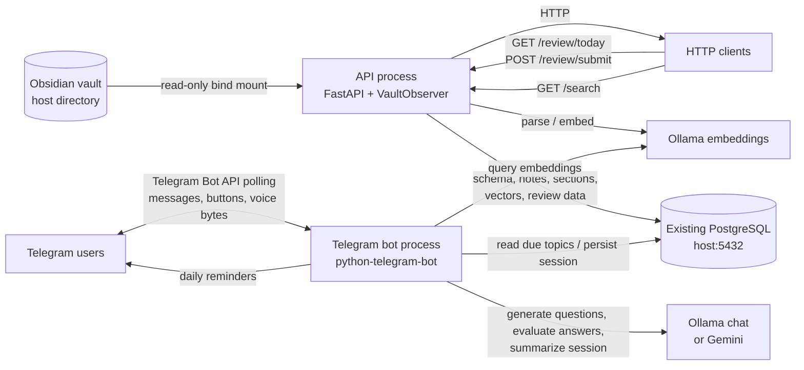
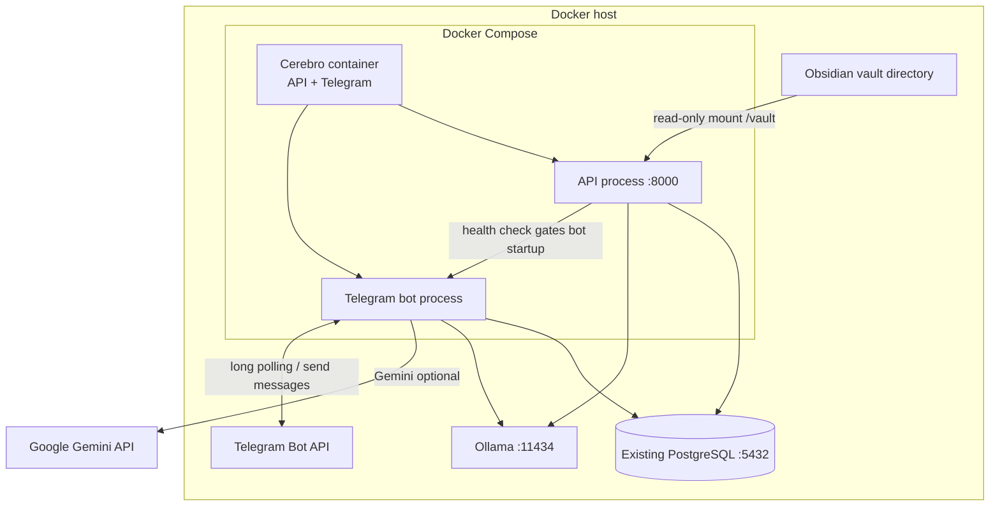
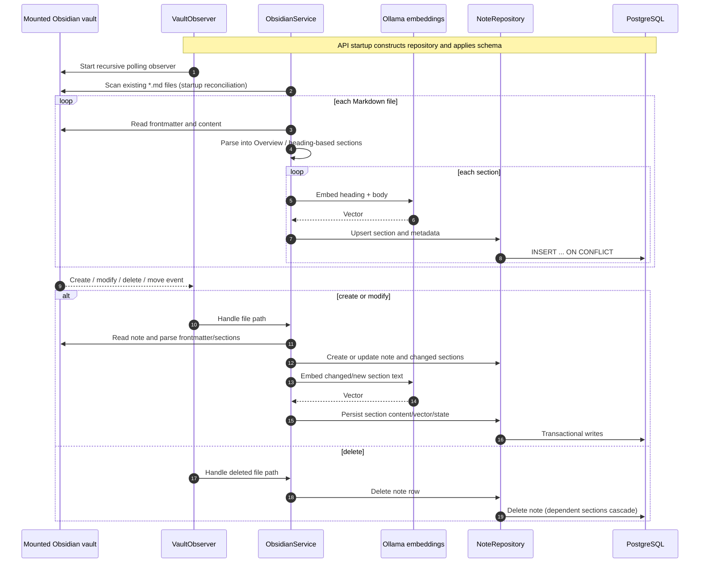
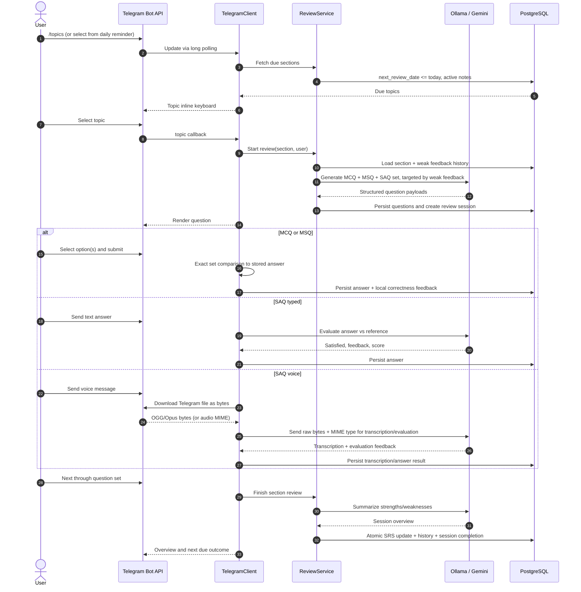
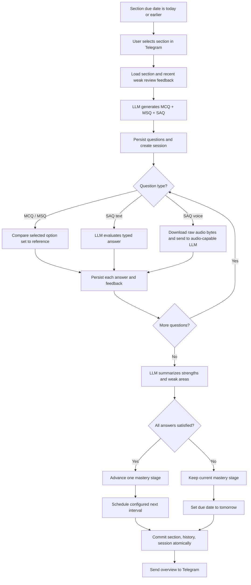

# Cerebro Architecture Brief

This document describes the application as implemented in this repository: its runtime processes, data flow, persistence model, deployment shape, and operational boundaries. It is an implementation map, not a claim that external services (PostgreSQL, Ollama, Gemini, Telegram) are bundled inside the application.

## System at a glance

Cerebro indexes an Obsidian vault into section records in PostgreSQL, maintains section embeddings for semantic search, and uses scheduled section due dates to drive active-recall sessions in Telegram. One Cerebro container runs the API and Telegram bot as supervised processes. The API owns the vault watcher and HTTP API; the bot polls Telegram, sends reminders, and collects answers.

### Runtime processes and responsibilities

| Component | What it actually does | What it depends on |
|---|---|---|
| API (`python -m app`) | Starts FastAPI, opens a pooled PostgreSQL client, applies the schema migration, starts the recursive vault observer, reconciles existing Markdown files, and serves health, review, and semantic-search routes. | PostgreSQL; mounted vault; Ollama embeddings; host port 8000. |
| Vault observer | Uses watchdog's `PollingObserver` to watch the mounted vault recursively. Markdown create/modify/delete callbacks are sent to `ObsidianService`; a move is handled as delete-old/create-new. | API process and readable vault path. Polling interval comes from watcher settings. |
| Obsidian service | Loads frontmatter, parses section headings (including nested heading paths), embeds section text, inserts/updates note and section rows, removes deleted sections, and deletes a note on file deletion. At API startup, it scans the vault to reconcile pre-existing notes. | Repository and Ollama embedding client. |
| PostgreSQL client/repository | Provides connection pooling, schema initialization, CRUD, due-section queries, question/session persistence, similarity ranking, and transactional session completion/SRS updates. | Existing PostgreSQL reachable from the containers. |
| Embedding client | Calls Ollama's embedding endpoint using the configured embedding model. Document and query text receive the model's document/query prefixes. | Ollama endpoint and model. |
| Review service | Selects due sections, loads previous weak feedback, generates a question set, evaluates text/voice answers, records answers, asks for a session overview, and invokes the final SRS update. | Repository plus configured Ollama chat or Gemini client. |
| Telegram bot | Polls Telegram; registers users; shows due topics; creates review sessions; displays MCQ/MSQ buttons and SAQ answer modes; validates MCQ/MSQ locally; routes text/voice SAQ responses to the evaluation service; sends daily reminders via JobQueue. | Telegram token/API; PostgreSQL; LLM; Gemini key for voice evaluation unless a future audio-capable client is configured. |
| LLM clients | Ollama handles question generation, text evaluation, and summaries. Gemini supports structured generation/evaluation and raw audio input. Audio is downloaded as bytes and sent with its MIME type; no local audio transcoding is performed. | Ollama and/or Gemini credentials according to provider and task. |
| MCP / Obsidian HTTP clients | Optional client modules in the tree, but not part of the active ingestion path. The current watcher reads the mounted filesystem directly. | Only relevant if separately invoked/integrated. |

## Container and deployment architecture

`docker-compose.yml` defines one long-running application service:

- `cerebro`: builds the `cerebro:latest` image and runs one container. Its launcher starts the API, waits for `/health`, then starts Telegram polling. Both processes share the container environment. The service mounts `${OBSIDIAN_VAULT_PATH}` at `/vault` read-only, exposes port 8000, and reports API health through `/health`.
- PostgreSQL is intentionally external to this Compose project. The container uses `host.docker.internal:5432` by default. Compose adds the host-gateway mapping for Linux; on other Docker environments `host.docker.internal` is generally provided by Docker Desktop. The host PostgreSQL listener and firewall must allow connections from Docker.
- Ollama is also external by default at `http://host.docker.internal:11434`. Gemini is an optional hosted LLM provider and uses `GEMINI_API_KEY`.

Configuration is loaded from environment variables / `.env`; `.env.example` documents expected values. Key settings include `OBSIDIAN_VAULT_PATH`, PostgreSQL host/port/user/password/database and pool sizes, `TELEGRAM_BOT_TOKEN`, `TELEGRAM_ALLOWED_USERS`, `TELEGRAM_REMINDER_TIME`, `LLM_PROVIDER`, Ollama endpoint/model names, and `GEMINI_API_KEY`. The API needs the vault mount; Telegram does not.

The API's `/health` response is a lightweight process health response; it does not actively probe PostgreSQL, Ollama, or vault readability after startup. Schema setup happens when `NoteRepository` is constructed. The API service starts the observer and then invokes startup vault reconciliation; reconciliation logs per-file errors and keeps the process running, whereas failure to start the required observer fails application startup.

## Data model and persistence

The repository bootstraps tables with idempotent `CREATE TABLE IF NOT EXISTS` and additive `ALTER TABLE` statements when `NoteRepository` is created.

| Table | Purpose / notable fields |
|---|---|
| `notes` | One row per canonical file path; title, topic, tags, status, timestamps. |
| `note_sections` | One row per parsed section; heading/content, stage/mastery, interval, last/next review, review count, embedding array/model/dimensions. Unique by `(note_id, heading)`. |
| `review_history` | Section review outcome, timestamp, score, combined user answer, and LLM overview/feedback. |
| `generated_questions` | Persisted JSON question payloads with `mcq`, `msq`, or `seq` type and active flag. Older questions are deactivated when a new set is generated. |
| `review_sessions` | Telegram user, section, completion state, satisfaction, aggregate score, and overview. |
| `review_answers` | Per-question user/reference answers, satisfaction and feedback; voice answers store their returned transcription when available. |
| `telegram_users` | Registered Telegram user and chat IDs used by the reminder job. |

Vectors are stored as PostgreSQL `REAL[]`, not the `pgvector` extension. Semantic search currently fetches active-note vectors and computes cosine similarity in Python; this is simple and portable but scans and transfers all vectors, so it is a scale limit for a large vault. There is no vector index configured.

On successful Telegram session completion, the repository locks the section row and, in one transaction, updates its review state, inserts one aggregate review-history record, and marks the session complete. Individual answers are persisted as they arrive. Review stages map to intervals of 1, 3, 7, 14, 30, 60, and 120 days. Passing advances one stage; a failed evaluation keeps the current stage and schedules tomorrow.

## Vault ingestion lifecycle

Parsing recognizes Markdown ATX headings (`#` through `######`), avoids interpreting headings inside fenced code blocks, creates an `Overview` section for leading unheaded text (or the whole note if no headings exist), and prefixes nested heading names with their hierarchy. Frontmatter title/topic/tags override filename/default metadata. Changed section content is re-embedded; a cosine-similarity heuristic can demote an existing stage when content changes materially. New sections start as novice and deleted sections are removed.

The observer is a polling observer (not native OS event hooks), filters Markdown files and dot-prefixed filenames, and handles file moves through delete/create callbacks. The current debounce configuration is not applied in the event callbacks, and file paths are persisted as paths visible inside the container (for Compose, typically `/vault/...`). Those operational details matter if the vault mount path changes between deployments.

## Telegram review lifecycle

`/start` authorizes (when an allow-list is configured), upserts the Telegram user's chat details, and then displays topics. `/topics` also works directly. A scheduled JobQueue task at `TELEGRAM_REMINDER_TIME` sends a reminder to registered active users when due content exists. This is a reminder, not automatic session creation.

MCQ/MSQ feedback is immediate and local: selected option text is compared as a set with the persisted reference key. The bot does not call the LLM for those answers. SAQ typed text and raw voice bytes are evaluated by the configured LLM path. The default Ollama client supports text but does not support raw audio, so voice evaluation requires Gemini credentials; when configured, voice evaluation can use Gemini even if Ollama is the selected general provider.

## Review and scheduling flows

The aggregate session is considered satisfied only when every answer is satisfied. Otherwise its aggregate score is capped at 2 and the section returns tomorrow. On a successful session, the stage advances one step and uses that stage's interval. Question-generation prompts include recent review feedback for scores below 4, so weak areas can influence follow-up questions. Session overview is LLM-generated; if summary generation fails, the service builds a fallback from persisted weak-answer feedback.

## HTTP and command entry points

| Interface | Behavior |
|---|---|
| `GET /` | Service name plus docs and health links. |
| `GET /health` | Lightweight API liveness response. |
| `GET /docs` | FastAPI's generated Swagger UI. |
| `GET /review/today` | Sections due on or before today. |
| `GET /review/refresh` | Re-fetches the same due-section list. |
| `POST /review/submit` | Direct/manual score submission and stage scheduling. This endpoint does **not** invoke LLM evaluation; when `satisfied` is omitted, score >= 3 determines pass. |
| `GET /search?q=...&limit=...` | Embeds a query with Ollama and ranks persisted section vectors in Python. |
| `python -m app telegram` | Runs Telegram polling bot. |
| `python -m app watch` | Standalone watcher mode; watches events but does not run startup reconciliation or API. |
| `python -m app` | Runs the API (and its embedded watcher). |

## Operational boundaries and improvement opportunities

The core flow is wired, but these are relevant if “production-ready” means resilient to restarts, larger vaults, or unreliable dependencies:

1. **Session recovery:** Telegram's active question index and selected options are held in an in-memory map keyed by Telegram user. Answers and session records persist, but an interrupted interaction cannot currently resume from PostgreSQL after bot restart.
2. **Duplicate event control:** Watcher debounce is configured but unused. Polling or rapid editor saves can trigger repeated reads/embeddings; content comparison prevents redundant embeddings for unchanged sections, but event coalescing would reduce load.
3. **Startup reconciliation consistency:** The observer starts before the initial scan to avoid missing changes during scanning, so the same note can be observed while reconciliation is processing. Upserts make much of this idempotent; a serialized work queue or per-file lock would make ordering explicit.
4. **Vector scale:** `REAL[]` plus Python cosine scans are not indexed nearest-neighbor search. For a large vault, migrate vectors to `pgvector`, add a vector index, and version dimensions/model changes.
5. **Embedding service availability:** An ingestion failure for an individual file is logged and skipped during initial reconciliation. There is no durable retry queue; a later file event or container restart/reconciliation is needed to retry it.
6. **Telegram API access and auth:** Telegram bot polling needs outbound internet access. The allow-list is optional; an empty list allows all users. Configure it for a private deployment.
7. **LLM/provider dependency:** Ollama and Gemini are outside Compose. Models must be pulled/available in Ollama; Gemini API credentials are required for the current raw-audio path. LLM evaluation latency or failures can interrupt answering; the bot tells the user and permits retry.
8. **Direct review API semantics:** `/review/submit` is a legacy/manual score pathway and bypasses the qualitative evaluation/session workflow. Use Telegram for the intended LLM-evaluated loop, or tighten/API-authenticate the route if exposed beyond a trusted network.
9. **Health depth and migrations:** `/health` does not verify downstream services. Schema creation is automatic but currently embedded in repository bootstrap rather than a separately versioned migration tool.
10. **Path identity:** Note keys use the path string visible to the container. Keep the mount target stable (`/vault`) so a host-side location change does not create duplicate database identities.

## Suggested next architecture steps

For a robust long-running deployment, the highest-value improvements are durable Telegram session state and resume support; per-file event debouncing/locking; pgvector with a migration/versioning strategy; retry/backoff around embedding and LLM failures; deep readiness checks; and authentication for HTTP endpoints. Keep PostgreSQL and model services external if that matches the host environment, but document their network/listener requirements and backup/retention responsibilities alongside Compose deployment instructions.
